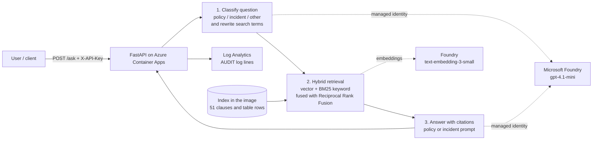

# Claims & Policy Copilot

A retrieval-augmented (RAG) assistant that answers questions about a **fictional UK motor insurance policy wording**, with a citation for every statement. It never decides a claim: for incident questions it explains what the wording says and refers the case to a claims handler.

Built on Microsoft Foundry and Azure Container Apps, with automated tests, an evaluation suite and a CI/CD pipeline that deploys on merge.

> **Everything here is synthetic.** The policy wording ("Northgate Motor Cover") is an original fictional document written for this project. It is not based on any real insurer's product, and no real customer data is used. The assistant is a portfolio project, not insurance advice.

## What it does

| You ask | The assistant does |
|---|---|
| A policy question ("Is a lost key covered at Essential level?") | Gives a direct answer with clause citations, e.g. `[6.3]` |
| An incident question ("I had two drinks and crashed, am I covered?") | Quotes the relevant cover and exclusions in three parts, gives **no verdict**, and ends by referring the case to a claims handler |
| Something not in the policy | Replies: "I can't find this in the policy wording." |

## Architecture



**How a question flows**

1. **Classify and rewrite.** One model call labels the question (policy, incident or other) and rewrites it into better search terms.
2. **Retrieve.** Clause-level chunks are ranked by embedding similarity and by BM25 keyword score, then fused with Reciprocal Rank Fusion (top 6). Definitions (section 1) are always included. For incident questions, exclusions (section 7) are added.
3. **Answer.** The prompt for the question type is used. Policy questions get a direct answer. Incident questions get a three-part answer with no verdict. Every statement must cite a clause or a table row.

**Table handling.** The cover-level table uses coloured squares (green = included, red = not included) in a symbol font, so normal text extraction loses the meaning. The ingestion script reads each cell's colour with `pdfplumber` and turns each row into text. The result was checked cell by cell against the source (55 of 55 correct).

## Live demo

- Health check: `https://ca-cpc-dev.nicebay-ab0b8606.uksouth.azurecontainerapps.io/health`
- `POST /ask` needs an API key, so it is not public. A short recorded demo is in `docs/demo.md`.
- The app scales to zero when idle, so the first request after a quiet period can take 20 to 40 seconds.

## Repository layout

```
src/api/          FastAPI app, question pipeline, Foundry clients
src/ingestion/    Chunking, table extraction, embedding scripts
data/synthetic/   The fictional policy wording (PDF)
data/processed/   Chunks, table rows, embeddings
evals/            Answer keys, evaluation runner, saved results, change log
tests/            Unit and API tests (fake pipeline, no Azure needed)
docs/             Deployment, ingestion and progress notes
.github/workflows CI (tests) and Deploy (build and release on merge)
Dockerfile        Container image for the API
```

## Run it locally

You need Python 3.11, the Azure CLI, and access to a Foundry project with a chat and an embedding deployment.

```
python -m venv .venv
.venv\Scripts\activate
pip install -r requirements.txt
az login
copy .env.example .env      # then fill in your own endpoint and deployment names
```

Start the API with the same command the Dockerfile uses (see its `CMD` line), then open `http://localhost:8000/docs`.

Never commit `.env` or the `logs/` folder. Both are in `.gitignore`.

## Tests

```
python -m pytest -q
```

13 tests cover the API (validation, key check, error handling) and the pipeline logic. They use a fake pipeline, so they need no Azure access and run in CI.

## Evaluation

The assistant was developed against answer keys in `evals/`. Each run records: whether the right clause was retrieved, whether the answer cited the correct source, needless referrals to a handler, whether the handler was named for incidents, correct refusals, question type detected, and seconds taken.

| Set | Questions | Purpose | Latest result |
|---|---|---|---|
| Dev set | 17 | Used while building | FILL_IN |
| Held-out set | 15 | Checked between versions | FILL_IN |
| Fresh set | 15 | Written after a design freeze | FILL_IN |

Saved runs are in `evals/`, and `evals/CHANGELOG.md` records what changed between versions and why.

## CI/CD

- **CI** (`.github/workflows/ci.yml`): runs the tests on every pull request and every push to `main`.
- **Deploy** (`.github/workflows/deploy.yml`): on merge to `main`, runs the tests, logs in to Azure with **OIDC** (no stored password; the credential only trusts the `main` branch), builds the image in Azure Container Registry tagged with the commit ID, updates the container app, and checks `/health`.
- The deploy identity has Contributor on one resource group only.

## Security and privacy

- The app reaches Foundry with a **managed identity**, so there are no model keys in code or settings.
- `/ask` requires an `X-API-Key` header. The key is stored as a Container Apps secret.
- Failures return a reference id, never internal details.
- Each answer writes an `AUDIT` log line (request id, question type, timing) to Log Analytics.
- Only synthetic data is used.

## Responsible AI

- The assistant explains the wording. It does not decide claims, assess fault or give a verdict.
- Incident answers always end with a referral to a claims handler.
- Answers are grounded in retrieved clauses, and questions outside the policy get a refusal rather than a guess.
- A real deployment would need a data protection impact assessment, review against the FCA Consumer Duty, human oversight of any decision, and model risk governance. These are not done here.

## Known limitations

- **Speed:** average answer time was about 4.4 s, so the 5 s p95 target was not met. Cold start after idle has not been measured.
- **Classifier:** 2 of 15 held-out questions were misclassified.
- **Evaluation:** scoring is keyword-based plus manual reading, and the held-out and fresh sets were used during development, so they are not untouched tests.
- **Search:** retrieval runs locally over an index stored in the image. Azure AI Search was planned but blocked by a free-tier quota error.
- **Citations:** the citation list shows the clauses retrieved, not only the ones the answer cited.
- **API docs:** `/docs` is public. Only `/ask` needs the key.

## Possible next steps

Azure AI Search for the index, a faster classifier model, an untouched final test set, branch protection and linting in CI, and a private endpoint for production.
